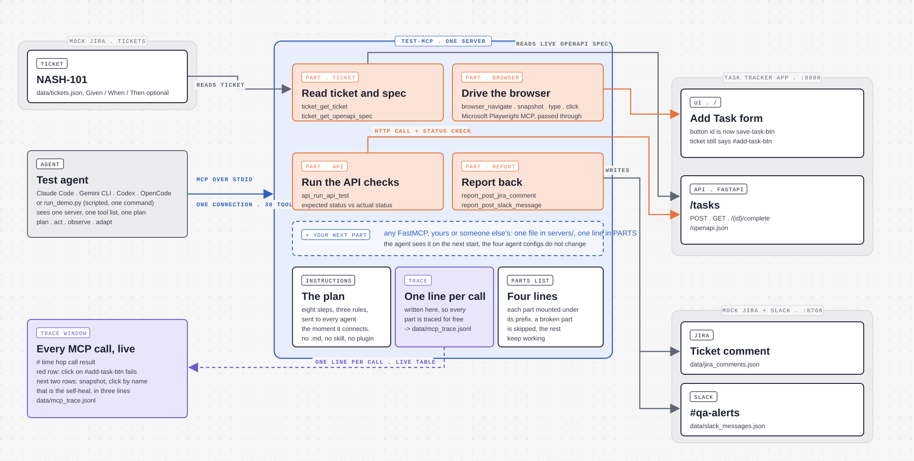

# MCP Test Agent

Demo tool for the NashLearn session "Building Test Agents with MCP Servers"
(23 Oct 2026). One Jira ticket goes in. The agent reads it, reads the live
API spec, tests the UI in a real browser, heals a broken locator, runs the
API checks, and reports back to Jira and Slack. Nobody presses a button in
between.



## Run it with one command

```bash
pip install -r requirements.txt
python run_demo.py
```

Needs Python 3.11+ and Node.js 18+ (for `npx @playwright/mcp`). The first
run downloads the Playwright MCP package, so do it once before going live.

`run_demo.py` starts the Task Tracker app on port 8000 and the mock
Jira/Slack dashboard on port 8766, opens the dashboard, connects to the four
MCP servers over stdio and runs the eight steps:

| Step | MCP server | What happens |
|---|---|---|
| 1 | ticket-spec | `get_ticket("NASH-101")`, finds Given/When/Then, the criteria and the old locator |
| 2 | ticket-spec | `get_openapi_spec()`, lists the real endpoints and prints the test plan |
| 3 | playwright | opens the app and takes an accessibility snapshot |
| 4 | playwright | types a task, clicks `#add-task-btn`, which fails, takes a new snapshot, clicks the button named "Add Task" and says so |
| 5 | api-test | four checks: create (201), list (200), complete (200), missing task (404) |
| 6 | reporting | posts the result to the NASH-101 comment thread |
| 7 | reporting | posts a short line to `#qa-alerts` |
| 8 | (console) | final summary: every check, plus the self-heal with its evidence |

The browser window stays visible so the audience can watch the click fail
and recover. At the end the dashboard stays live until you press Enter.
Exit code is 0 only when every check passed.

Options: `--headless` (no browser window), `--fast` (no pause between
steps), `--no-dashboard` (don't open the dashboard tab), `--no-wait` (exit
straight away).

The planted drift: the ticket still names the button `#add-task-btn` from
older automation, but the app now uses `save-task-btn`. Its label is still
"Add Task", which is what the agent finds in the snapshot.

## Scripted run vs live agent

`run_demo.py` makes the same MCP tool calls an LLM agent makes, but its
decisions are written in code, so it runs the same way every time. Use it
for rehearsals and as the fallback when a live run stalls.

For the live agent, open Claude Code in this folder. `.mcp.json` registers
the four servers (approve them the first time). Start the app and the
dashboard yourself:

```bash
uvicorn demo_app.main:app --port 8000
uvicorn servers.reporting.dashboard:app --port 8766
```

Then give one instruction: `Test ticket NASH-101 and report the results.
Follow AGENT_RUNBOOK.md.`

If a port is already in use (a leftover uvicorn from a rehearsal), stop
that process first.

## Layout

```
run_demo.py               one-command demo (MCP client for all four servers)
.mcp.json                 the same four servers, for Claude Code
AGENT_RUNBOOK.md          instructions for an LLM agent
data/tickets.json         the mock Jira ticket NASH-101
demo_app/                 Task Tracker app under test (FastAPI + one HTML page)
servers/ticket_spec/      MCP: get_ticket, get_openapi_spec
servers/api_test/         MCP: run_api_test
servers/reporting/        MCP: post_jira_comment, post_slack_message + dashboard
tests/                    unit tests and end-to-end tests
```

## Tests

```bash
pytest tests/unit
pytest tests/integration
```

`tests/integration/test_run_demo.py` runs `run_demo.py --headless` end to
end, so it needs Node.js and network access the first time.
